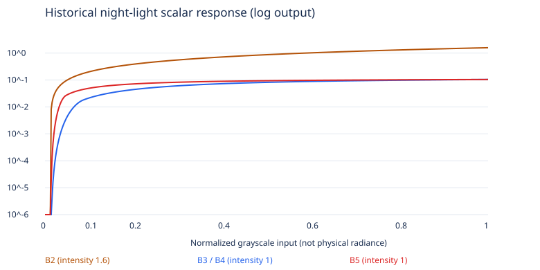

# Night-texture response diagnosis

Historical pre-change diagnosis of the Task 1B-4 emission response. The
[original record](https://github.com/keepraw/Keepraw-Fly/blob/8090372ac6d02d2c4c9dec4c09c78c2444f4641b/docs/visual-review/task-1b-5/diagnosis.md)
contains every regional measurement and earlier response formula. These grayscale
visualization signals are not calibrated luminance. See [current Globe implementation](../../../globe.md)
and the [legacy evidence inventory](../../../visual-review/README.md) for current ownership.

## Evidence and cause

The recorded source and derived texture hashes matched NASA provenance; sampled
RGB channels agreed. Sampling used geographic neighborhoods rather than airport
positions. Full histograms and pixel bounds remain in the
[texture audit](../../../visual-review/task-1b-5/texture-audit.json), which is also
an input to the current response unit tests.

- Source positive urban-core medians were 0.71–0.99; the 4K medians remained
  0.70–0.96. Downsampling reduced peaks/detail but did not erase the city clusters.
- The earlier response combined a 0.012 subtraction, a 0.075-wide smooth toe,
  a 1.25 power and a bounded shoulder. At inputs 0.02 / 0.04 / 0.10, its scalar
  output was 0.000041 / 0.001860 / 0.021640, while bright cores approached 0.104.
  Weak peripheral signals were disproportionately suppressed.
- Dark controls had at least 99.8% near-zero source pixels. Rare nonzero values
  could not automatically be identified as cities. The noise threshold remained
  necessary; simply multiplying every output would also brighten peaks/noise.
- Raw night data used `NoColorSpace` and contributed linearly before ACES Filmic
  and sRGB output. The diagnosis did not find a night-texture color-space bug.
  Actual WebGL on/off comparisons were needed to isolate emission from the lit surface.

## Decision and verification meaning

Separate low-end roll-in, midtone shoulder and peak controls to recover peripheral
signals around 0.03–0.20 while retaining the 0.012 noise floor and the old bounded
peak. Preserve positive tonal ordering and verify dark-control pixels instead of
inferring correctness from a brighter screenshot. This explains the constraints
in `apps/web/src/globe/globe-night-response.test.ts`.

The plot shows earlier curves with default intensity, excluding palette and solar
mask; it is a historical explanation, not a current response plot. The original
per-region table, implementation chronology and old screenshots remain in Git
history. The [approved Control](../../../visual-review/task-1b-7b2/README.md) records
subsequent design acceptance rather than this investigation's status.
