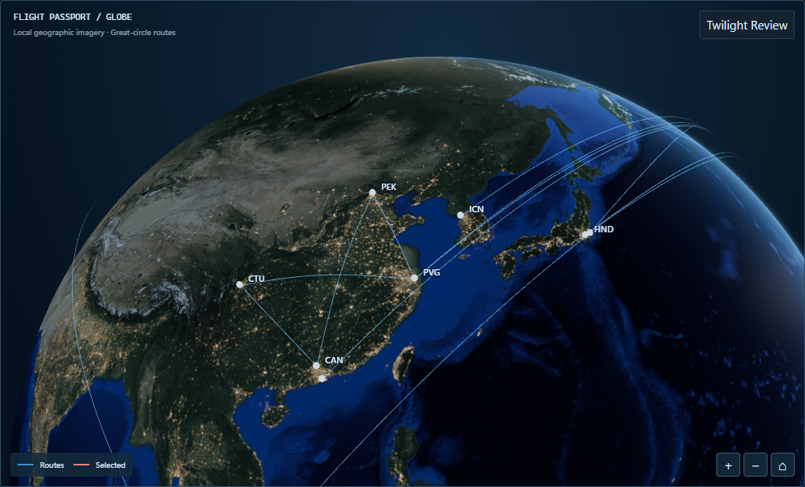

# Task 1B — Approved Control and canonical Globe evidence

The owner approved **Control** as the immutable Globe baseline for subsequent development. This is a historical Task 1B record: the Owner subsequently accepted Task 2C and Task 3, and PRs #34 and #35 were merged. The official Desktop Passport now uses the approved production 3D Globe (with SVG fallback). No frozen Control image, camera or lighting setting is changed by this documentation update.

## Canonical references

All six PNGs remain byte-identical to checkpoint `8e759707c1c265b360183160f6fe369428e30b4a`. [Canonical manifest](canonical-manifest.json) preserves original scene, lighting, camera, dimensions, bytes and SHA-256.

| Reference                                                           | Purpose                                        |
| ------------------------------------------------------------------- | ---------------------------------------------- |
| [Approved Dark Control](comp-control-fixed-dark.png)                | Authoritative owner-approved visual            |
| [Light Control](comp-control-fixed-light.png)                       | Theme counterpart                              |
| [Passport allocation, Dark](comp-control-passport-dark.png)         | Future integration size reference              |
| [Selected SFO → HKG](comp-control-selected-SFO-HKG-dark.png)        | Long-haul selection hierarchy                  |
| [Post-specular Passport, Light](specular-fixed-passport-light.png)  | Light regression at actual Passport allocation |
| [Post-specular PEK → PVG](specular-fixed-selected-PEK-PVG-dark.png) | Short-haul selected route regression           |

## Frozen technical decisions

- Approved lighting: sun intensity **0.7**, twilight width **0.18**, atmosphere **2.0**, night **2.0**, exposure **1**, art direction A. Fixed world sun `[-0.2926889023874383, 0.290121517531001, 0.9111326530669097]`.
- Control Home: direction `[-0.5458180578508808, 0.23870391298836036, -0.803183098457592]`, distance **2.1**, offset `(-0.0459629031778328, -0.5004980895646883)` in the recorded Lab allocation. Home/compose algorithms remain data-dependent and frozen for Task 2.
- Approved ocean specular refinement: `pow(NdotH, 60.0) * 0.16`, gated by facing and `0.25 + 0.75 * diffuse`. Historical pre-refinement response was `pow(NdotH, 220) * 0.38`. No further surface/atmosphere/city kernel changes.
- Recorded Demo: 24 flights, 23 directed routes, 22 physical strokes, 20 airports. Passport outer map allocation at the checkpoint: **998 × 576.0625**, client **996 × 574**. These are historical measurements, not Task 2 dimensions.
- Real-time solar mode uses actual UTC and the existing minute/visibility cadence. Fixed mode restores the canonical direction. No clouds, Bloom, post-processing or production WebGL integration.

## Provenance

The six references and their original scene records remain local. Superseded A/B
experiments and cleanup inventories are archived in [the pre-cleanup Git tree](https://github.com/keepraw/Keepraw-Fly/tree/0412603fe518471c3816883cce8ff37680d60265/docs/visual-review/task-1b-7b2).
B/C camera experiments were rejected in favor of Control and are not implementation
recommendations. The approved Dark Control remains an input to the retained
Task 2C font capture. Historical measurements do not define current page geometry.

## Historical verification

The checkpoint recorded passing workspace typecheck/build and 216 web + 66 core + 31 validator tests (plus CSS-token tests). Focused system-Chrome Globe verification recorded 12/12 passes after the documented solar/night threshold recalibration. Deterministic UTC tests use June/December 2026 clocks and wait for rendered lighting before sampling. These results are retained as historical facts, not claimed as Task 2 validation.

Photographic cloud depth remained deferred at this historical checkpoint; the official Passport 3D integration was completed later in Task 3. See the [Task 3 screenshot index](https://github.com/keepraw/Keepraw-Fly/blob/0412603fe518471c3816883cce8ff37680d60265/docs/visual-review/task-3/SCREENSHOTS.md) for the approved historical production evidence, [Task 4 cleanup](https://github.com/keepraw/Keepraw-Fly/blob/0412603fe518471c3816883cce8ff37680d60265/docs/visual-review/CLEANUP-2026-10-10.md) for the earlier inventory, and [post-Task A cleanup](https://github.com/keepraw/Keepraw-Fly/blob/0412603fe518471c3816883cce8ff37680d60265/docs/visual-review/CLEANUP-2026-10-11.md) for the earlier six-image baseline inventory.
