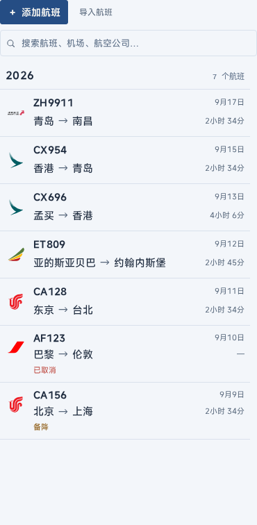
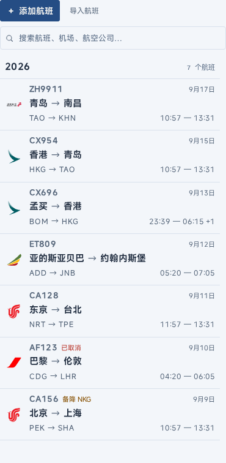
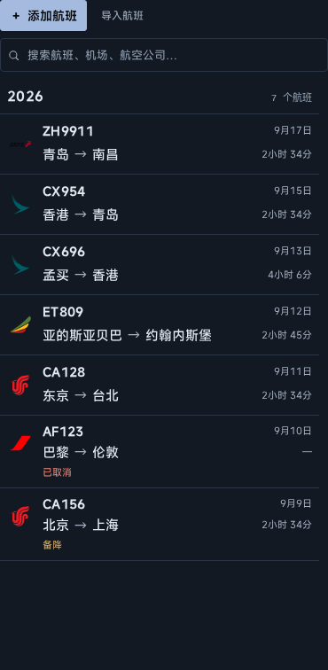
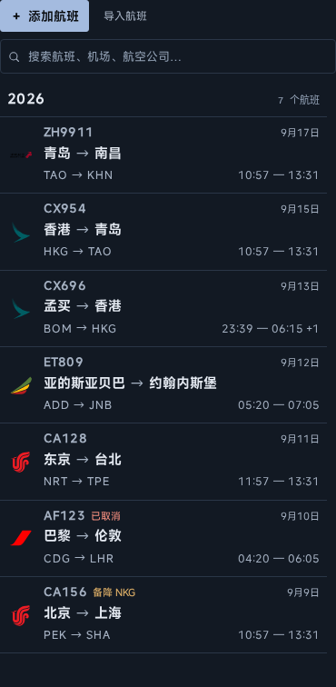
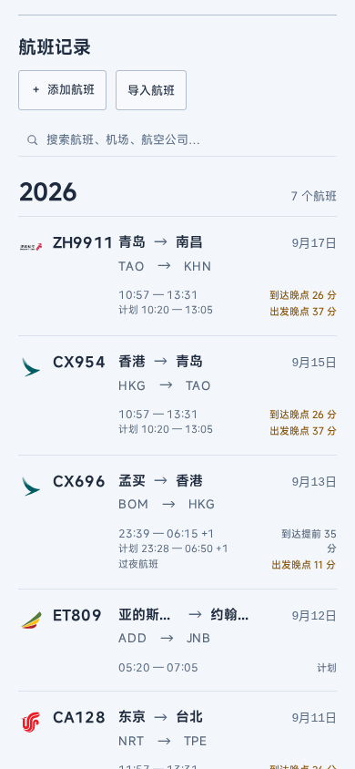
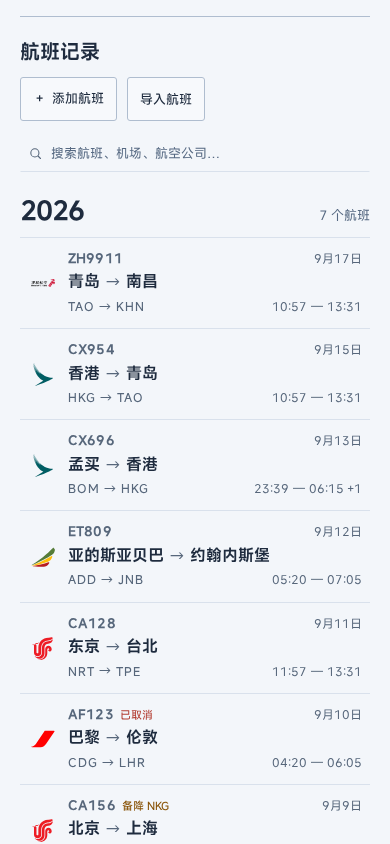
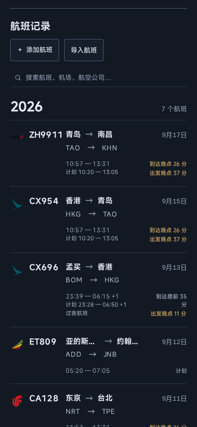
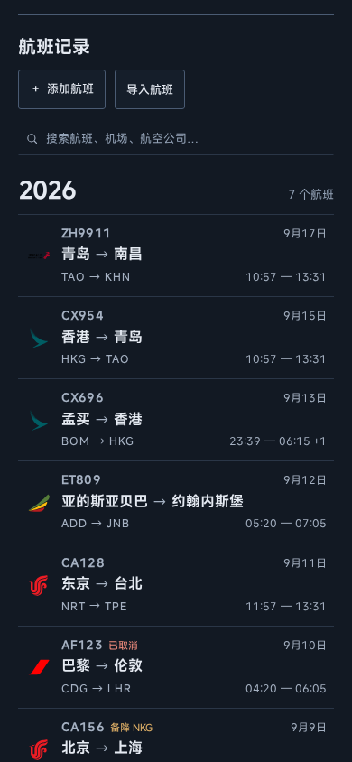

# Task 5B — Flighty 风格航班列表

基于 PR #40 合并后的 main `b87b338`。改造前后均使用同一份
[七条合成航班数据](../../../e2e/fixtures/flight-list-review.keepraw-fly.json)，包含实际时间、仅计划时间、跨日到达、长城市名、取消及备降。

## 信息层级

- 航班号与日期在上方，城市路线为视觉主体。
- IATA 三字码和一组出发 / 到达时间在下方；每个端点分别优先实际时间，没有实际时间时显示计划时间。跨日到达保留 `+1`。
- 仅取消、备降显示简短标记；备降标记附实际备降机场代码。城市路线仍显示原航线。
- 移除列表中的航司全名、飞行时长、延误 / 提前分钟数、常规状态和重复计划时间。详情页保留完整信息。
- 长城市名完整换行。沿用 Passport 语义色彩、原有 Logo 及 PR #40 的城市名称规范化 / 城市群翻译。

## 同数据截图对照

桌面列表截图包含搜索和年份分组；移动截图滚动到航班列表。桌面完整 Passport 截图见下方链接。

| 布局 / 语言 / 主题           | 改造前                                                   | 改造后                                                  |
| ---------------------------- | -------------------------------------------------------- | ------------------------------------------------------- |
| 桌面 1440×900 · 简体 · Light |       |       |
| 桌面 1440×900 · 简体 · Dark  |  |  |
| 移动 390×844 · 简体 · Light  |             |             |
| 移动 390×844 · 简体 · Dark   |        |        |
| 桌面 1024×768 · 英文 · Light | [截图](before/en-light-1024x768-list.png)                | [截图](after/en-light-1024x768-list.png)                |
| 移动 430×932 · 英文 · Dark   | [截图](before/en-dark-430x932.png)                       | [截图](after/en-dark-430x932.png)                       |
| 桌面 761×900 · 繁体 · Dark   | [截图](before/zh-TW-dark-761x900-list.png)               | [截图](after/zh-TW-dark-761x900-list.png)               |
| 移动 360×800 · 繁体 · Light  | [截图](before/zh-TW-light-360x800.png)                   | [截图](after/zh-TW-light-360x800.png)                   |

完整桌面 Passport：Light [改造前](before/zh-CN-light-1440x900.png) / [改造后](after/zh-CN-light-1440x900.png)；Dark [改造前](before/zh-CN-dark-1440x900.png) / [改造后](after/zh-CN-dark-1440x900.png)。

截图使用真实 Chromium 浏览器、已加载字体及航空公司 Logo。桌面使用 WebGL Globe，移动端不创建地图。
[改造前测量](before/measurements.json)和[改造后测量](after/measurements.json)记录完整行文字、行高、页面溢出及渲染器；`baseCommit` 标识比较基线。

390px 简体普通航班行从约 131px 降至 91px；1440px 桌面行从 68px 变为约 84px，增加了原先缺少的机场代码和起降时间。所有截图宽度均无页面横向溢出。

## 回归验证

新增列表测试覆盖三语言的完整长城市名、Light / Dark / System、360px 移动及 761px 窄侧栏、12 / 24 小时制、跨日标记和实际 / 计划时间回退，并在 Chromium、Firefox、WebKit 执行。

保留现有 360–1440px 响应式矩阵、三块移动统计面板、无移动地图、整行点击、悬停、键盘焦点、选中 / Globe 联动及详情返回滚动恢复检查。整行区域点击和键盘焦点分别用桌面、移动独立用例覆盖，避免增加点击区域后单个用例累计超时。列表年份标题显式使用 Passport 文字 Token，修正英文移动 Dark 下继承旧文字色的问题。

类型检查、格式、CSS lint、Token 检查、单元测试、构建和全部配置中的 E2E 均必须通过；最终结果见 Draft PR 的 CI 检查。

## 复现截图

```sh
pnpm install --frozen-lockfile
pnpm exec playwright install chromium
pnpm dev
# 另一个终端，在对应版本运行：
node scripts/flight-list-review.mjs before
node scripts/flight-list-review.mjs after
```

改造前使用 main `b87b338` 的应用源码，复制当前分支的截图脚本和合成数据后执行 `before`；当前分支执行 `after`。脚本通过真实导入、语言和外观设置生成截图，无需修改存储或主题逻辑。

本次应用修改限定于 FlightRow、列表样式及样式入口；Globe、统计公式、数据 Schema、筛选 / 持久化、字体和第三方素材分发均未修改。CI 工作流保持原样，`deploy.if: ${{ false }}` 继续禁用 Pages 部署。
